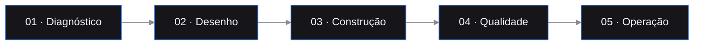

  

  
  
  
  

  Projetamos e construímos o que fica entre os seus sistemas e as suas decisões: 
  <b>pipelines de dados, agentes de IA, painéis e produtos digitais sob medida.</b> 
  Equipe enxuta e sênior, do desenho à operação.

 

## O que fazemos

Oito frentes que se combinam conforme o problema. Entramos onde o dado nasce e vamos até a tela em que alguém decide.

<table>
  <tr>
    <td width="50%" valign="top">
      <h3>Engenharia de dados e pipelines</h3>
      Arquitetura, ingestão, orquestração e qualidade de dados em nuvem, com pipelines que aguentam produção.  
      <code>Airflow</code> <code>BigQuery</code> <code>Postgres</code> <code>data lakes</code>
    </td>
    <td width="50%" valign="top">
      <h3>IA aplicada, agentes e automações</h3>
      Agentes e automações com modelos de linguagem integrados aos seus sistemas, com controle e rastreabilidade.  
      <code>agentes</code> <code>MCP</code> <code>APIs</code> <code>WhatsApp</code>
    </td>
  </tr>
  <tr>
    <td valign="top">
      <h3>Painéis, BI e observabilidade</h3>
      Painéis executivos e operacionais que mostram o que importa, com alerta quando algo sai do lugar.  
      <code>Grafana</code> <code>Streamlit</code> <code>Looker</code> <code>séries temporais</code>
    </td>
    <td valign="top">
      <h3>Software sob encomenda e produtos</h3>
      Plataformas web, APIs e produtos digitais completos, do desenho à operação.  
      <code>SaaS multi-tenant</code> <code>FastAPI</code> <code>Node</code> <code>Next.js</code>
    </td>
  </tr>
  <tr>
    <td valign="top">
      <h3>Infraestrutura como código e nuvem</h3>
      Ambientes reproduzíveis, versionados no Git e criados por código, com implantação contínua e monitoramento desde o primeiro dia.  
      <code>Terraform</code> <code>contêineres</code> <code>CI/CD</code> <code>FinOps</code>
    </td>
    <td valign="top">
      <h3>Qualidade de software e automação de testes</h3>
      Estratégia de testes, suítes automatizadas e quality gates no pipeline, para cada versão chegar à produção com risco conhecido.  
      <code>testes automatizados</code> <code>performance</code> <code>quality gates</code>
    </td>
  </tr>
  <tr>
    <td valign="top">
      <h3>Gestão de produtos digitais e de dados</h3>
      Product Owner dedicado: requisitos, backlog, prioridades e status reports que mantêm negócio e engenharia na mesma página.
    </td>
    <td valign="top">
      <h3>Mapeamento de sistemas e processos</h3>
      Diagnóstico do que já existe, com sistemas, integrações e fluxos documentados e um plano de evolução priorizado.
    </td>
  </tr>
</table>

## Como trabalhamos

| | Etapa | O que acontece |
|:--:|---|---|
| `01` | **Diagnóstico** | Entendemos o problema de negócio, os dados que existem e o que impede a decisão hoje. |
| `02` | **Desenho** | Arquitetura, ferramentas e fluxos definidos. Você valida antes de qualquer linha de código. |
| `03` | **Construção** | Entregas curtas e frequentes, com testes e revisão. Você ajusta o rumo no caminho. |
| `04` | **Qualidade** | Testes funcionais e automatizados, performance e dados conferidos antes de publicar. |
| `05` | **Operação** | Produção, monitoramento e documentação que a sua equipe entende e mantém. |

## Produtos que construímos e operamos

<table>
  <tr>
    <td width="33%" valign="top">
      <b>The Fit Player</b> 
      SaaS white-label para treinadores e academias  
      Plataforma multi-tenant com treinos, avaliações e área do aluno.
    </td>
    <td width="33%" valign="top">
      <b>Clínica Éden</b> 
      Site institucional de estética avançada  
      Identidade própria, animações sob medida e desempenho alto no celular. 
      <a href="https://www.edenclinica.com">edenclinica.com</a>
    </td>
    <td width="33%" valign="top">
      <b>Time APEX</b> 
      Página do método de treino  
      Apresentação do método, pensada para transformar visitantes em alunos.
    </td>
  </tr>
  <tr>
    <td colspan="3" valign="top">
      <b>Documentação dos produtos</b> 
      Um site por produto, em português e inglês, com busca e um assistente que responde a partir da própria documentação  
      Guias passo a passo com as telas reais, mapa interativo do produto e feedback em cada página. 
      <a href="https://docs.datariun.com">docs.datariun.com</a> · <a href="https://task-finance.docs.datariun.com">task-finance.docs.datariun.com</a>
    </td>
  </tr>
</table>

## Ferramentas do dia a dia

  
  
  
  
  
  
  
  
  
  
  
  
  
  
  

## Sócios

Cinco sócios fundadores, cada um à frente de uma especialidade e todos com responsabilidade direta sobre o que entregamos.

| | Sócio | Especialidade |
|:--:|---|---|
|  | [**Paulo Rebouças**](https://pauloreboucas.datariun.com/) | Dados, IA e software |
|  | [**Henrique Marcossi**](https://henriquemarcossi.datariun.com/) | Qualidade e IA aplicada a testes |
|  | [**Nathalia Marcossi**](https://nathaliamarcossi.datariun.com/) | Qualidade e validação de sistemas |
|  | [**Mirian Rebouças**](https://mirianreboucas.datariun.com/) | Engenharia e produtos de dados |
|  | [**Bruno Galvão**](https://brunogalvao.datariun.com/) | Front-end, design systems e interfaces de IA |

 

### Vamos conversar sobre o seu próximo projeto.

 

